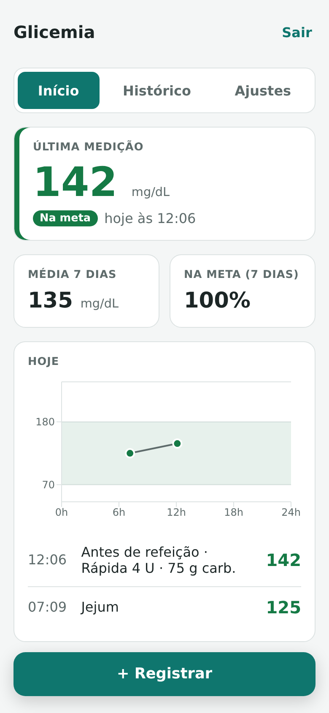
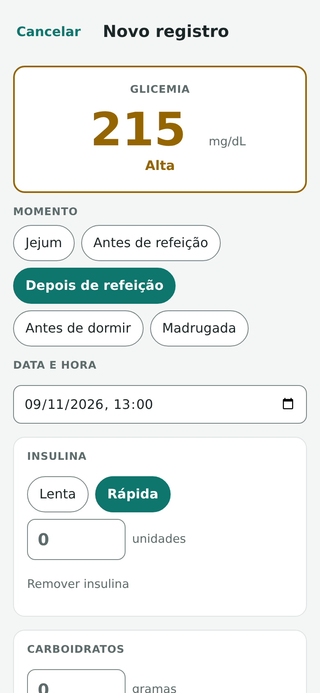
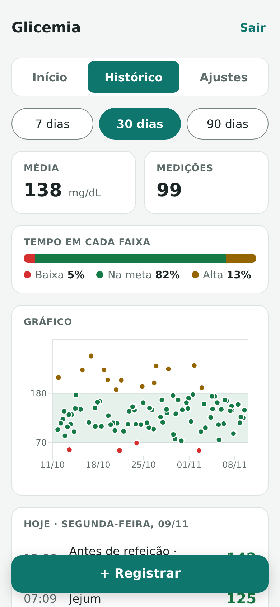
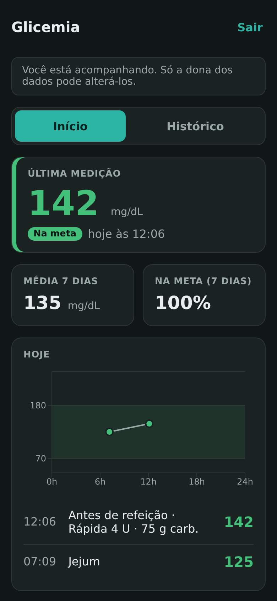

# Glicemia

App web instalável no celular para uma pessoa com **diabetes tipo 1** registrar glicemia, insulina e carboidratos em poucos segundos. Os familiares acompanham as medições em **modo somente leitura**.

Feito sob medida para uma família, com custo zero de operação, como alternativa aos apps de assinatura.

<p align="center">
  
  
  
  
</p>

<sub>Imagens com dados fictícios.</sub>

## O problema

Quem tem diabetes tipo 1 mede a glicemia várias vezes por dia, muitas vezes com pressa e no celular. Os apps de mercado são genéricos ou cobram assinatura, e raramente deixam a família acompanhar sem também poder alterar os dados.

O produto foi definido numa entrevista antes de qualquer código. O PRD completo está em [`PROJETO.md`](PROJETO.md).

## O que o app faz

- **Registro rápido:** a tela abre pronta para digitar o valor, e só a glicemia é obrigatória.
  - A data, a hora e o momento (jejum, antes ou depois de refeição...) vêm preenchidos sozinhos.
  - Insulina (lenta ou rápida), carboidratos e observação são opcionais.
- **Faixas de cor:** baixa, na meta e alta, sempre com texto junto da cor. Os limites são ajustáveis conforme a meta do médico.
- **Tela inicial:** a última medição em destaque, a média e a % na meta dos últimos 7 dias, e o gráfico e a lista do dia.
- **Histórico:** 7, 30 ou 90 dias, com média, tempo em cada faixa, gráfico do período e lista por dia.
- **Modo acompanhante:** os familiares entram com o próprio login e só leem. Os dados se atualizam quando eles voltam ao app.
- **Instalável (PWA):** ícone na tela inicial, abertura em tela cheia e atualização automática. Temas claro e escuro seguem o celular.

## Decisões que valem destacar

- **Segurança no banco, e não só na tela.** As permissões são regras do próprio Postgres (Row Level Security, em [`app/supabase/esquema.sql`](app/supabase/esquema.sql)): só a dona dos dados cria, edita ou apaga; acompanhantes vinculados só leem; quem não tem vínculo ou não tem login não vê nada. Os limites de valores, como a glicemia entre 20 e 600, também são validados no banco. As regras foram testadas simulando cada perfil.
- **O app não calcula dose de insulina.** Ele registra o que foi aplicado, mas nunca sugere quanto aplicar. Um erro nesse cálculo pode causar hipoglicemia grave, e essa decisão cabe ao médico ou a aparelhos certificados.
- **Sem cadastro aberto.** As contas são criadas à mão, e ninguém fora da família consegue se registrar.
- **Acessibilidade como critério de pronto.** O app é usado às pressas e às vezes em hipoglicemia, quando a visão e a coordenação pioram. Uma skill do Claude Code ([`.claude/skills/acessibilidade`](.claude/skills/acessibilidade/SKILL.md)) faz duas verificações a cada mudança:
  - o contraste WCAG de cada par de cores, nos dois temas;
  - uma auditoria de todas as telas no navegador, com o axe-core e checagens próprias: bordas de campos, alvos de toque de 44px, foco visível e zoom de 200%.

  A primeira auditoria apontou 236 problemas, e todos foram corrigidos.

## Tecnologias

| Camada | Escolha |
|---|---|
| Interface | React 19, TypeScript, Vite |
| Gráficos | Recharts |
| App instalável | vite-plugin-pwa (manifesto e service worker) |
| Login e banco | Supabase (Auth + Postgres com RLS) |
| Hospedagem | Vercel |
| Testes de ponta a ponta e acessibilidade | Playwright, axe-core |

## Estrutura

```
├── PROJETO.md                   PRD: visão, escopo, funcionalidades, privacidade e andamento
├── app/
│   ├── src/                     telas (componentes/), regras de faixa e período, acesso ao Supabase
│   ├── supabase/esquema.sql     tabelas, limites e regras de acesso (RLS)
│   └── public/                  ícones do app
├── .claude/skills/acessibilidade/
│   ├── SKILL.md                 regras e fluxo de acessibilidade do projeto
│   └── scripts/                 contraste.py (cores) e auditar.py (telas)
└── docs/imagens/                imagens deste README
```

## Como rodar

Requer Node 20 ou mais novo e um projeto gratuito no [Supabase](https://supabase.com).

1. No Supabase, abra o **SQL Editor** e rode o conteúdo de `app/supabase/esquema.sql`.
2. Em **Authentication**:
   - crie os logins (**Add user**);
   - desligue **Allow new users to sign up**;
   - para cada familiar, insira um vínculo na tabela `acompanhantes` (`paciente_id`, `acompanhante_id`).
3. Copie `app/.env.example` para `app/.env.local` e preencha com o endereço e a chave **pública** do projeto.
4. Rode:

```bash
cd app
npm install
npm run dev        # http://localhost:5173
```

Para verificar a acessibilidade, com o app rodando:

```bash
python3 .claude/skills/acessibilidade/scripts/contraste.py
python3 .claude/skills/acessibilidade/scripts/auditar.py
```

## Como foi feito

O projeto foi construído em parceria com o [Claude Code](https://claude.com/claude-code), baseando-se em um curso da Alura. As decisões de produto vieram de uma entrevista registrada no `PROJETO.md`. O desenvolvimento seguiu quatro etapas, cada uma testada antes da próxima:
1. o dia a dia no app;
2. o banco com as regras de acesso;
3. o login e o modo acompanhante;
4. a publicação como app instalável.

## Status

Projeto concluído. A versão publicada e o banco de dados foram desativados, e o código fica aqui como portfólio.
